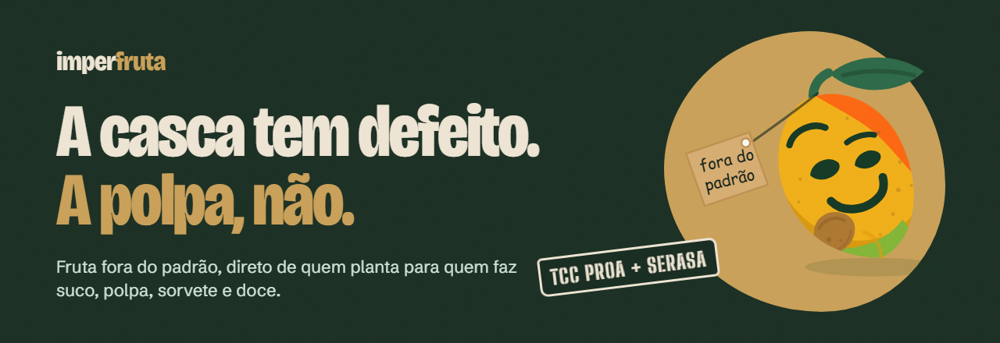
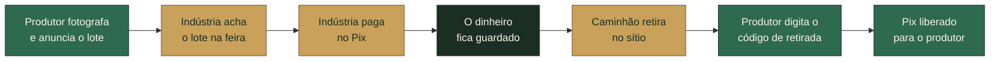
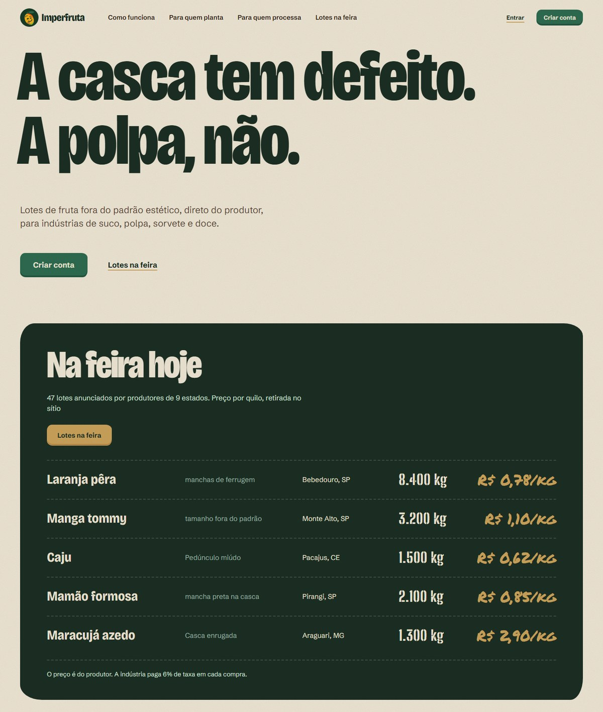
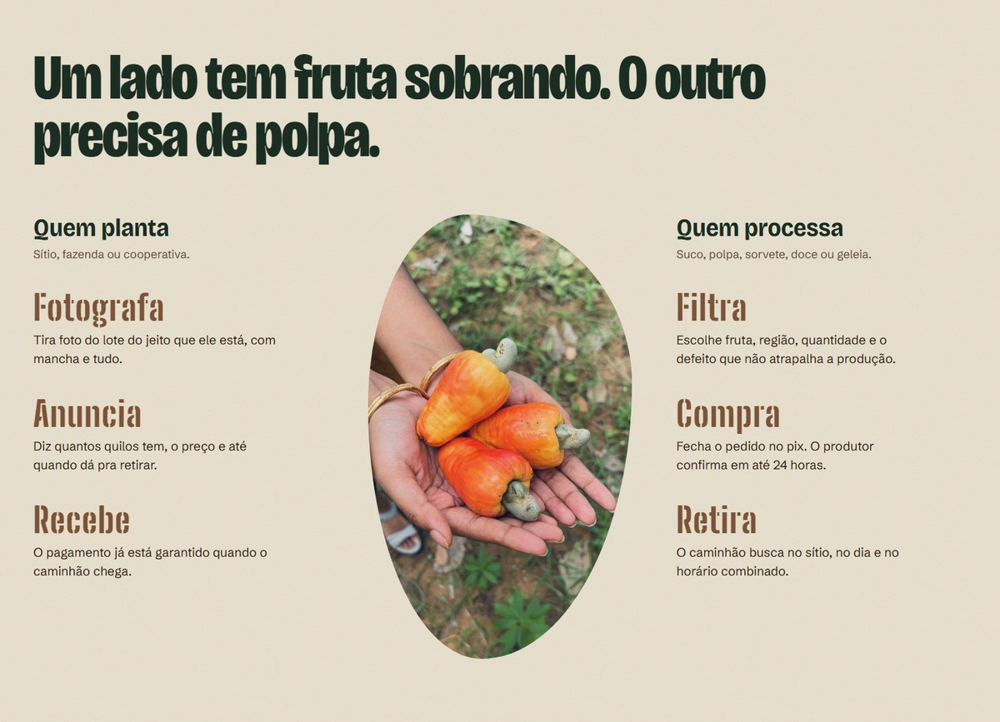
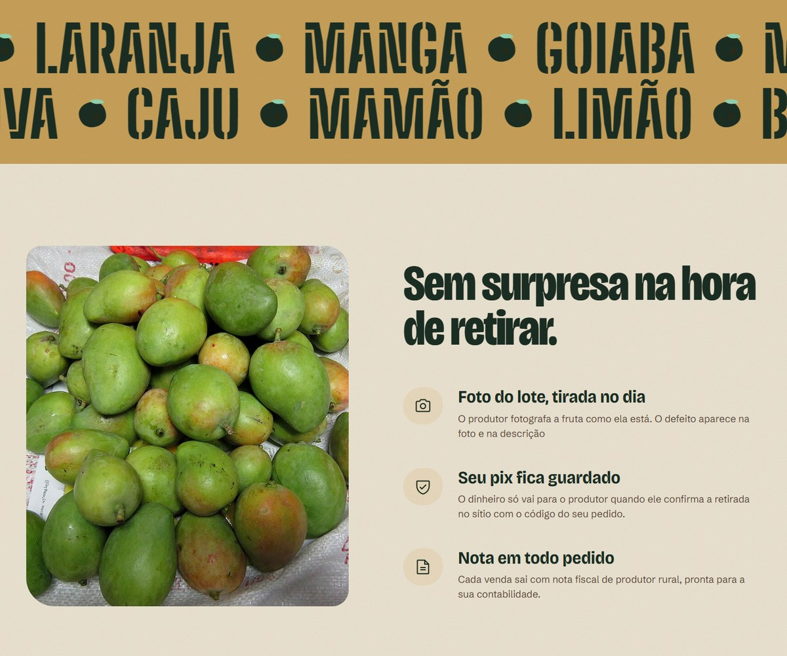
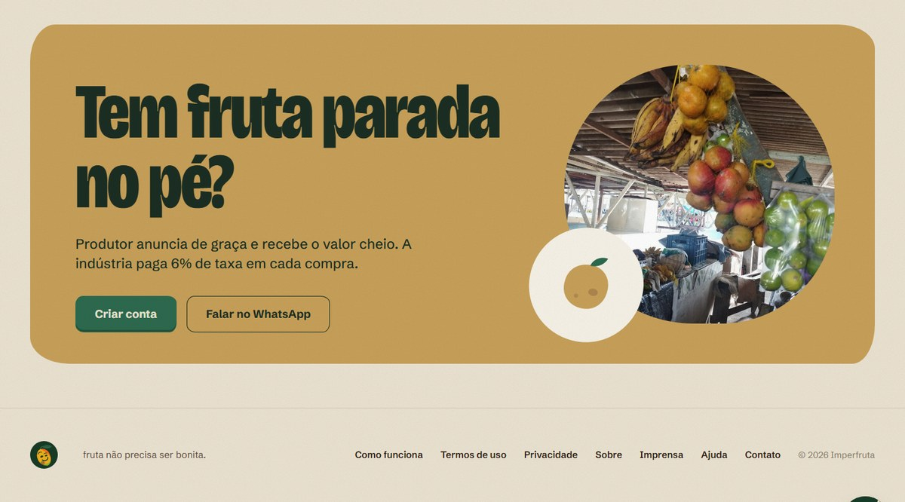
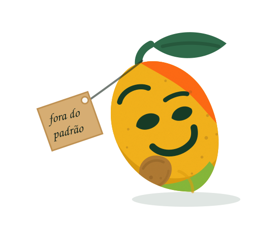
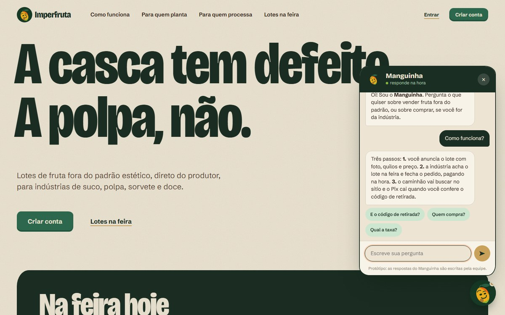
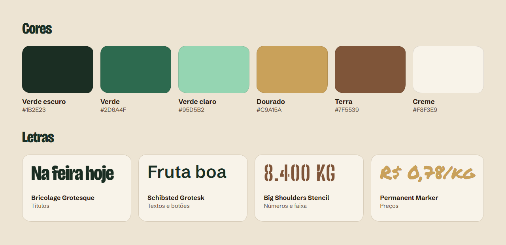

<div align="center">



<br><br>


</div>

## Sumário

- [Sobre o projeto](#sobre-o-projeto)
- [Como o projeto nasceu](#como-o-projeto-nasceu)
- [Para que serve](#para-que-serve)
- [Como funciona](#como-funciona)
- [As telas](#as-telas)
- [O Manguinha](#o-manguinha)
- [Identidade visual](#identidade-visual)
- [Páginas do site](#páginas-do-site)
- [Tecnologias](#tecnologias)
- [Como abrir o projeto](#como-abrir-o-projeto)
- [Pastas](#pastas)
- [Equipe](#equipe)

## Sobre o projeto

O ImperFruta é um site que aproxima quem planta de quem processa fruta.

O produtor anuncia a fruta que o mercado recusa pela aparência. A indústria de suco, polpa, sorvete e doce encontra esse lote, compra direto do produtor e manda buscar no sítio.

É uma feira na internet, só que de fruta fora do padrão.

## Como o projeto nasceu

O ImperFruta é o nosso TCC do Proa com a Serasa, na trilha de Front-end.

A ideia partiu de um problema que pouca gente vê. Muita fruta boa não chega ao mercado porque tem mancha na casca, tamanho fora do padrão ou formato torto. Por dentro ela está perfeita, mas a fruta de mesa é escolhida pela aparência. O que sobra fica no pé ou vai para o lixo.

Do outro lado está a indústria de suco, polpa, sorvete e doce. Ela descasca, corta e bate a fruta, então a aparência não faz diferença. O que importa é sabor, quantidade e preço.

Os dois lados precisam um do outro e não se encontram. O ImperFruta é a ponte entre eles.

O nome junta as palavras **imperfeita** e **fruta**.

### O tamanho do problema

| O dado | De onde vem |
|---|---|
| Todo ano, 1,3 bilhão de toneladas de comida se perdem ou são desperdiçadas no mundo. É 30% de tudo o que se produz. | [FAO, publicado pela ONU Brasil](https://brasil.un.org/pt-br/78207-fao-30-de-toda-comida-produzida-no-mundo-vai-parar-no-lixo) |
| Mais da metade disso (54%) se perde antes de chegar ao consumidor: na produção, no armazenamento e no transporte. | [FAO, publicado pela ONU Brasil](https://brasil.un.org/pt-br/78207-fao-30-de-toda-comida-produzida-no-mundo-vai-parar-no-lixo) |
| Reduzir as perdas de alimentos na produção e no abastecimento é a meta 12.3 dos Objetivos de Desenvolvimento Sustentável da ONU. | [ODS 12, ONU Brasil](https://brasil.un.org/pt-br/sdgs/12) |

## Para que serve

| Para quem | O que ganha |
|---|---|
| **Quem planta** | Vende a fruta que ia perder. Anuncia de graça e recebe o preço cheio que pediu. |
| **Quem processa** | Acha fruta boa para a produção, direto do produtor, escolhendo a região, a quantidade e o defeito. |
| **Todo mundo** | Menos fruta boa no lixo. |

## Como funciona



No desenho, o verde é o que o produtor faz, o dourado é o que a indústria faz e o verde escuro é o que o site faz.

### O passo a passo de cada lado

| | Quem planta | Quem processa |
|---|---|---|
| **1** | **Fotografa** o lote do jeito que ele está, com mancha e tudo | **Filtra** por fruta, região, quantidade e defeito |
| **2** | **Anuncia** quantos quilos tem, o preço e até quando dá para retirar | **Compra** pelo Pix. O produtor confirma em até 24 horas |
| **3** | **Recebe** o pagamento, que já está garantido quando o caminhão chega | **Retira** no sítio, no dia e no horário combinados |

### O que dá segurança para os dois lados

- **O pagamento vem antes.** A indústria paga no fechamento do pedido e o dinheiro fica guardado.
- **O código de retirada.** O motorista chega ao sítio com um código. O produtor confere a carga, digita o código e o Pix é liberado na hora.
- **Se der errado, ninguém perde.** Se o caminhão não aparecer ou o produtor recusar, o dinheiro volta para a indústria e a fruta continua com o produtor.
- **O preço é do produtor.** A indústria paga 6% de taxa em cada compra. O produtor não paga para anunciar.
- **O frete é de quem compra.** O caminhão da indústria busca a fruta no pomar.

## As telas

<p align="center">
  <br>
  <em>A abertura e o quadro com os lotes do dia</em>
</p>

<p align="center">
  <br>
  <em>O que faz cada lado</em>
</p>

<p align="center">
  <br>
  <em>A faixa das frutas e as garantias da compra</em>
</p>

<p align="center">
  <br>
  <em>A chamada final</em>
</p>

## O Manguinha

<table>
  <tr>
    <td width="260" align="center">
      
    </td>
    <td>
      <p>O Manguinha é o mascote do ImperFruta.</p>
      <p>Ele é uma manga torta, com uma mancha de sol na bochecha e a etiqueta <strong>fora do padrão</strong> pendurada no cabo. Ele é o resumo do projeto: tem defeito na casca e é bom por dentro.</p>
      <p>No site ele fica no botão redondo do canto da tela e conversa com quem tem dúvida.</p>
    </td>
  </tr>
</table>

### O que ele responde

| Assunto | Exemplo de pergunta |
|---|---|
| Como o site funciona | Como funciona? |
| Taxa | Qual a taxa? |
| Pagamento | Como é o pagamento? |
| Código de retirada | E o código de retirada? |
| Que fruta pode ser anunciada | Que fruta serve? |
| Quem compra | Quem compra? |
| Frete | Quem busca a fruta? |
| Anúncio e cadastro | Como anuncio um lote? |
| Atendimento | Quero falar com uma pessoa |

<p align="center">
  <br>
  <em>O Manguinha respondendo como o site funciona</em>
</p>

### Como ele funciona por dentro

O Manguinha não usa inteligência artificial. As respostas foram escritas pela equipe e ficam no arquivo `assets/js/chat.js`.

1. Cada resposta tem uma lista de palavras-chave.
2. O chat tira os acentos e as letras maiúsculas da pergunta.
3. Ele procura as palavras-chave dentro da pergunta e mostra a resposta da palavra mais específica.
4. Se nenhuma palavra aparece, ele diz que não sabe e indica o WhatsApp da equipe.

## Identidade visual

<p align="center">
  
</p>

- **Cores de terra e de folha**, para lembrar o campo e a fruta madura.
- **Cantos tortos de propósito.** Os botões, as caixas e as fotos não são retângulos perfeitos, porque a fruta também não é.
- **Letra de carimbo e letra de pincel**, como nas caixas e nas placas de preço de uma feira.

## Páginas do site

| Página | Arquivo | Situação |
|---|---|---|
| Página inicial | `index.html` | HTML pronto, CSS em andamento |
| Anunciar lote | `pages/anunciarlot.html` | Em andamento |
| Pedidos recebidos | `pages/pedidosrecebidos.html` | Começada |
| Entrar e criar conta | `pages/login.html` | A fazer |
| Lotes na feira | `pages/lotsnafeira.html` | A fazer |
| Meus produtos | `pages/meusprodutos.html` | A fazer |
| Meus pedidos | `pages/meuspedidos.html` | A fazer |
| Detalhe do pedido | `pages/detalhedopedido.html` | A fazer |
| Acompanhar pedido | `pages/acompanharpedido.html` | A fazer |

## Tecnologias

| Tecnologia | Para que usamos |
|---|---|
| HTML | A estrutura de todas as páginas |
| CSS | O visual, as colunas e a versão para celular |
| JavaScript | A conversa com o Manguinha |
| Google Fonts | As letras Bricolage Grotesque, Schibsted Grotesk e Permanent Marker |

O projeto não usa framework nem biblioteca.

## Como abrir o projeto

1. Baixe o projeto:

```bash
git clone https://github.com/nsmlarissa/ImperFruta.git
```

2. Abra a pasta no VS Code.
3. Clique com o botão direito no `index.html` e escolha **Open with Live Server**.

Sem o Live Server também funciona: é só abrir o `index.html` no navegador.

## Pastas

```
ImperFruta/
├── index.html          página inicial
├── pages/              as outras páginas
└── assets/
    ├── css/            um arquivo de CSS para cada página
    ├── images/         fotos e ícones do site
    ├── js/             chat.js, a conversa com o Manguinha
    └── readme/         imagens usadas neste README
```

O `style.css` é o CSS da página inicial. Cada página de `pages/` tem o CSS com o mesmo nome dela.

## Equipe

- Arthur Santos Cavalcante
- Bruna Alves Souza dos Santos
- Evellyn Aparecida Queiroz Gomes dos Santos
- Larissa Vitória Ramos Nascimento
- Luan Carlos da Silva Arengue
- Paulo Henrique Dorea Simões
- Rafael Moisés da Silva Santos

## Aviso

Este site é um protótipo de estudo. Os lotes, os preços, os nomes e os pedidos que aparecem nas telas são exemplos.
